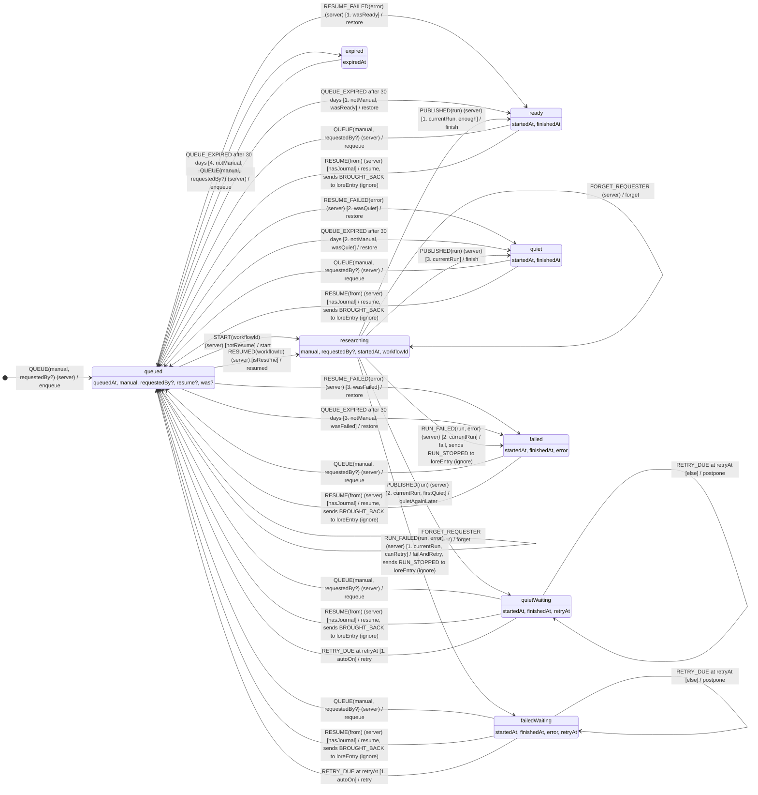
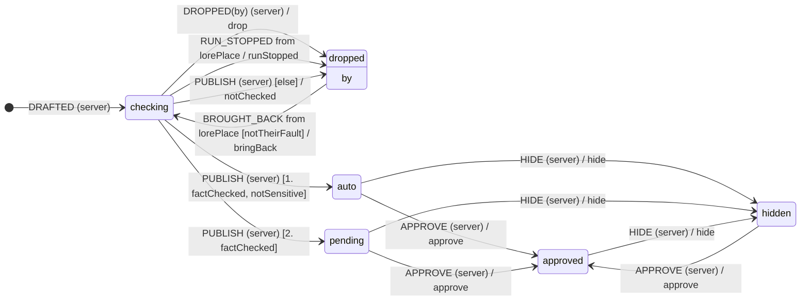

# State machines

Generated by `npm run diagrams` from the machines' rules in `convex/loreMachines.ts`. Don't edit by hand: `npm test` fails when it's out of date.

Each arrow is a transition or a link in the rules. Under each state are its own data fields (`?` if optional). `[*] -->` is how a row is born and `--> [*]` a final state. `(server)` events come from Walkies' own code, `from <machine>` from the other machine, and `after`/`at` from a timer. A list is tried in order: `[1. guard]`, then the next, and `[else]` last. What an effect writes, and which rows a link finds, are in the code.

## Both machines, and the links between them

## `lorePlace`, on `lorePlaces.state`

## `loreEntry`, on `loreEntries.state`

