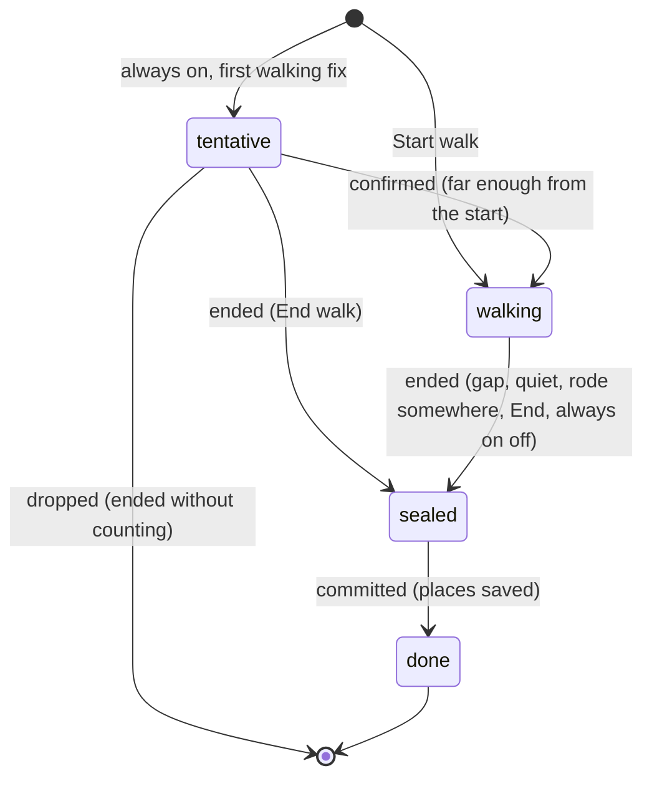

# Walk lifecycle

Every walk moves through one set of stages, defined in `Walkies/Model/WalkStage.swift`
and `android/.../model/WalkStage.kt`, with the allowed moves listed once in
`shared/fixtures/walk-stages.json`. Both platforms test their transition function against
that table.

A ride seen mid-walk isn't a stage: it's saved on the open walk as `rideSeen`, so after a
relaunch the next walking fix still knows whether you could have walked from the last spot.
If you couldn't, the walk ends there and the next outing starts as `tentative`.

## The two rules

1. **A walk closes the moment it ends.** Its route, end time and tile credit are written
   to its own file straight away, and the tracker is free for the next outing. Nothing
   waits on the step count: steps are asked for afterwards and filled in when they arrive,
   then the walk syncs again. There's never more than one walk recording, so there's no
   queue of "next outing" seeds and no finish to hand over.
2. **Saved places only ever hold finished walks.** While a walk records, its new tiles are
   shown on the map but left out of `cities.json` (`AppModel.committedCities`). When it
   closes, its credit (first-discovery tiles per place) is worked out against saved places
   that contain every earlier walk and nothing later, so the earlier walk always wins a
   shared tile.

## Closing a walk, crash by crash

1. `sealed`: the walk file is written with `endedAt`, its credit and `stage: sealed`.
   A crash here leaves a sealed walk whose credit isn't in `cities.json` yet. Launch adds it
   (a set union, so doing it twice is harmless) and carries on to 2.
2. Places are saved with the walk's credit and flushed to disk.
3. `done`: the walk file is saved again with `stage: done`. A short outing that doesn't
   count as a walk keeps its tiles as a `TileCredit` on each place, and its file is deleted
   only now.

A walk still recording when the app is killed is picked up again on launch: its points are
traced once more to show its tiles, or it's closed if it's too old to resume.

## Saved walks from older versions

Walks without a `stage` are treated as `done` if they have an `endedAt`. Unfinished ones
(including a finish that was waiting on steps, and the next outing it carried) are closed on
the first launch with the credit they'd already saved. Their tiles are already in
`cities.json`, because older versions saved tiles live.
